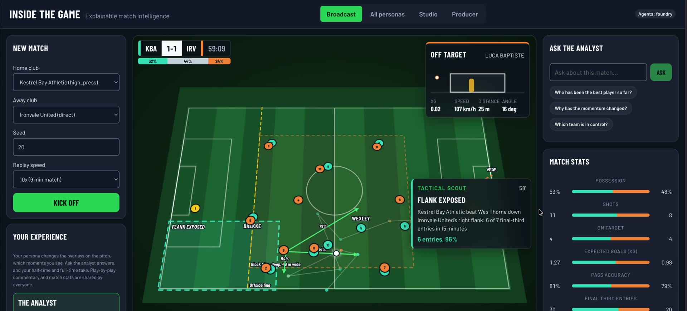
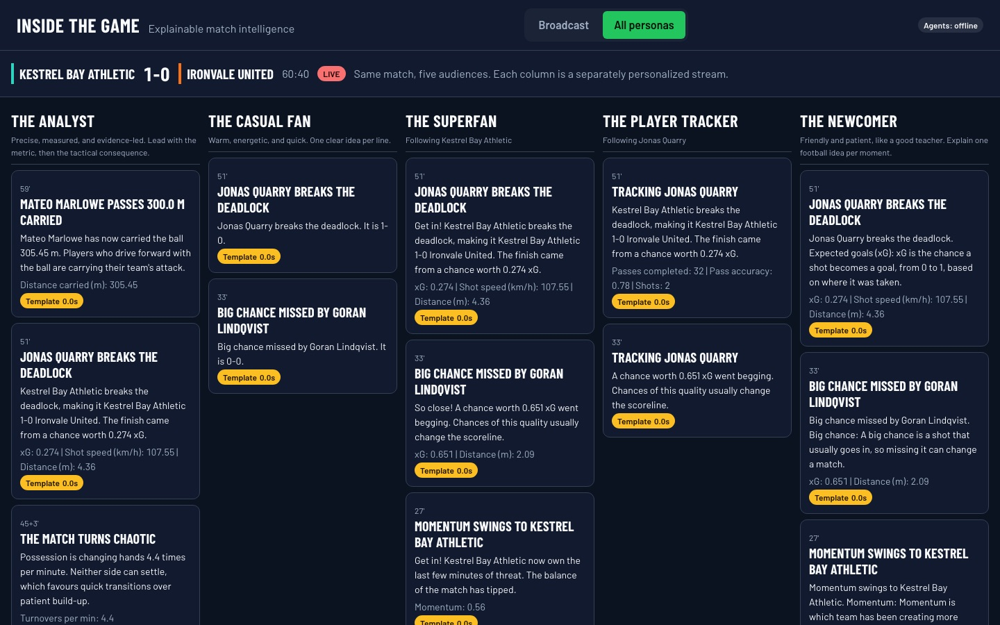
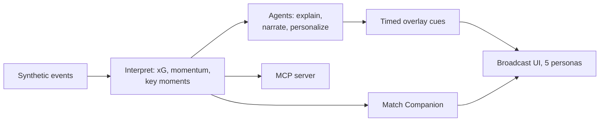

<!--
Inside the Game is an entry for the Microsoft x Premier League Developer Hackathon.
It turns synthetic, football-realistic match events into explainable match intelligence, live narratives, and personalized recaps.
This README describes the project status, setup, usage, and repository structure.
-->

# Inside the Game

AI-powered match intelligence built on synthetic football event data: ingest live events, interpret them into statistics and patterns, explain why moments matter, render overlay-ready output, and personalize it for analysts and casual fans in multiple languages.





See [docs/ARCHITECTURE.md](docs/ARCHITECTURE.md) for diagrams of the pipeline, the multi-agent workflow,
and the Azure deployment, and [docs/SUBMISSION.md](docs/SUBMISSION.md) for the project summary.



## Status

- Stage 1 (Ingest source): synthetic match engine implemented and calibrated.
- Stage 2 (Interpret): streaming analytics implemented (xG, pass difficulty, stats, rhythm, key moments).
- Stages 3-5 (Explain, Render, Personalize): multi-agent workflow, overlay cues, and recaps implemented.
- Live API: real-time replay with personalized server-sent event streams implemented.
- Broadcast frontend: live pitch, five persona overlays, stats, momentum, commentary, recaps, and multiview implemented.
- Azure deployment: infrastructure as code, container, CI, and keyless Foundry auth ready (`azd up`).

## Synthetic Match Engine

A seeded, deterministic possession-chain simulator generates full 90-minute matches between fictional clubs.
Each team has a tactical style (possession, direct, high press, counter) that adapts to the game state:
trailing teams chase late, leading teams protect. Outcomes are driven by player attributes, pitch geometry,
pressure, and fatigue.

Calibrated averages over 100 simulated matches:

| Metric | Simulated | Typical top-flight range |
|---|---|---|
| Shots per match | 24.4 | 22-28 |
| Goals per match | 2.82 | 2.5-3.0 |
| Goals per shot | 0.115 | 0.10-0.12 |
| Pass accuracy | 80% | 75-88% |
| Tackles per team | ~21 | 15-22 |

Event types: `period_start`, `period_end`, `kick_off`, `pass`, `carry`, `shot`, `goal`, `save`, `pressure`,
`tackle`, `interception`, `foul`, `possession_change`. Coordinates are metres on a 105 x 68 pitch, relative to the
acting team (attacking toward x = 105).

## Planned Stack

- Microsoft Agent Framework: agents, tools, structured outputs, workflow orchestration, OpenTelemetry
- Microsoft Foundry: project and model deployment, keyless managed identity access, hosted agent in Foundry
  Agent Service using the project's MCP server
- Azure Container Apps, Azure Container Registry, Log Analytics, Application Insights
- Model Context Protocol server exposing match intelligence to GitHub Copilot and Foundry agents
- Azure Developer CLI with Bicep infrastructure as code; GitHub Actions CI and OIDC deployment

## Synthetic Datasets

The simulator and analytics engine double as a dataset factory. One command produces analytics- and ML-ready
JSON Lines tables across every fixture pairing:

```bash
.venv/bin/python -m insidegame.datasets.generate --matches 48 --start-seed 1 --out data/synthetic
```

| File | Contents |
|---|---|
| `matches.jsonl` | Clubs, styles, score, possession, xG, key moment count |
| `events.jsonl` | Every event with absolute coordinates, xG, pass difficulty, momentum, rhythm state, triggered moments |
| `players.jsonl` | Per-player match statistics |
| `moments.jsonl` | Labelled key moments with importance and facts |
| `tracking.jsonl` | Ball and all 22 player positions in the absolute home frame, sampled every fifth event |
| `README.md` | Generated dataset card: parameters, schema, statistics, intended uses, limitations |

Twelve matches (about 30,000 events) generate in under two seconds. A two-match sample is committed in
[`data/sample/`](data/sample/README.md). The files load directly into Microsoft Fabric lakehouses, notebooks,
or training pipelines.

## Match Interpretation (Stage 2)

`MatchAnalyzer.ingest(event)` interprets each event as it arrives, with no I/O:

- **Expected goals (xG):** independent logistic model on shot distance, goal angle, and pressure.
- **Pass quality:** explainable 0-100 difficulty rating from length, pressure, progression, final-third target,
  and switch of play, with every factor returned for explanation.
- **Running statistics:** per player and per team, including possession share, progressive passes,
  final-third entries, shot speed, and carry distance.
- **Game rhythm:** five-minute rolling momentum (-1 away to +1 home), control (pass share), and chaos
  (turnover rate above a typical-match baseline), labelled as `balanced`, `home_control`, `away_pressure`, `chaos`, etc.
- **Key moments:** goals (with assist and game-state change such as equaliser or go-ahead), big chances missed,
  great saves, speed indicators (shots of 115 km/h or more), distance indicators (completed passes of 40 m or
  more, players passing 300 m and 400 m carried), difficult passes, momentum swings, chaos spells, and
  milestones (braces, hat-tricks, pass counts). Each moment carries an importance score and structured facts for the
  explanation agents. About 19 moments are detected per match.

## Agents and Personas (Stages 3-5)

Seven specialised Microsoft Agent Framework agents, each with a single role:

| Agent | Role | Output schema |
|---|---|---|
| Match Analyst | Explains why a moment matters; calls statistics tools (`get_player_stats`, `compare_teams`, `recent_moments`) | `Explanation` |
| Lead Commentator | Writes one broadcast-ready commentary line | `Commentary` |
| Personalization Producer | Rewrites the explanation for a viewer persona | `PersonaCard` |
| Broadcast Translator | Localises cards, keeping names and numbers intact | `TranslatedCard` |
| Match Editor | Writes half-time and full-time recaps | `MatchRecap` |
| Standards Editor | Fact-checks every model-written card and commentary line before air; rejected cards go back to the personalizer with the issues | `FactCheckVerdict` |
| Match Companion | Answers viewers' questions about the live match in their persona and language; calls statistics tools; declines off-topic or betting questions | `CompanionAnswer` |

Five personas, each a genuinely different experience:

| Persona | Voice | Words | Sees moments from importance | Overlay |
|---|---|---|---|---|
| The Analyst | Precise, metric-first, technical vocabulary | 70 | 0.30 | Stat panel |
| The Casual Fan | Warm, quick, no jargon or decimals | 30 | 0.60 | Lower third |
| The Superfan | Passionate and partisan for a favourite club | 40 | 0.45 (own club only, plus all goals) | Hype banner |
| The Player Tracker | Everything framed around one tracked player | 45 | every moment involving the player | Player tag |
| The Newcomer | Patient teacher, explains one concept per moment | 55 | 0.55 | Explainer card |

Every viewer also chooses a language, and optionally a favourite club and player.

**Trust and resilience**

- **Structured outputs:** every agent returns a Pydantic schema, never free text.
- **Numeric grounding:** every number an agent writes must appear in the moment's evidence or in its own tool
  results (recorded in an evidence ledger). Rounding and percentage forms are accepted; invented numbers are not.
- **Self-correction:** a rejected answer is retried once with the rejection reason.
- **Fallbacks:** if a model times out or fails twice, a deterministic template produces a valid, grounded output,
  so the broadcast never shows an empty overlay. Every output records its source (`model`, `model_retry`, `fallback`),
  attempts, and latency.

## Multi-Agent Workflow

Each broadcast-worthy moment runs through a Microsoft Agent Framework workflow:

```
intake -> analyst -> +-> narrator -------+-> fact-checker -> assembler -> overlay cues
                     +-> personalizer ---+        |              (translator for non-English viewers)
                         (per viewer)             +-> rejected card -> personalizer revises -> re-check
```

- **Shared state:** intake and analyst write the job and explanation to workflow state; the assembler joins the
  parallel branches using that state.
- **Producer policy:** decides what goes to air. Goals always air; other moments need a relevant viewer and a
  45-second gap since the last overlay, with at most two moments per event.
- **Overlay cues (stage 4, render):** one timed, machine-readable cue per viewer with layout, display start
  (match second), duration, priority, title, body, stat callouts, commentary line, theme, and provenance
  (source, attempts, latency per agent).
- **Fact-checking:** a roster rule rejects invented players, then the Standards Editor agent checks attribution
  and outcomes. A rejected card returns to the personalizer with the issues for one revision; if it still fails,
  a grounded template airs instead. Every cue records the verdict (approved, revised, replaced, or skipped).
- **Recaps:** the Match Editor writes half-time and full-time recaps at each period end, with a grounded
  standout-player check.
- **Failure recovery:** each agent falls back individually; if the workflow itself fails, a degraded
  template path still produces cues for every viewer.

`MatchIntelligenceService.handle_event(event)` runs the whole pipeline for one event.

## Live API

A FastAPI service replays simulated matches in real time and streams personalized intelligence over
server-sent events. Interpretation runs inline at match pace; agent workflows and recaps run as background
tasks and publish when ready, so the event feed never waits for a model. Under a slow or rate-limited model,
moments queue in order for a few production slots (`PARALLEL_MOMENTS`); a non-goal moment that falls more than five
match minutes behind the clock while queued is skipped, since its overlay would no longer be shown. Goals are never
skipped.

| Method | Path | Purpose |
|---|---|---|
| GET | `/api/health` | Lightweight liveness (configuration only) |
| GET | `/api/diagnostics` | One minimal real model call proving provider, credentials, and deployment |
| GET | `/api/clubs`, `/api/personas`, `/api/languages` | Metadata for building a viewer profile |
| POST | `/api/matches` | Start a replay: `{home, away, seed, speed}` (speed = match seconds per real second) |
| GET | `/api/matches`, `/api/matches/{id}` | List sessions; session state, snapshot, and recaps |
| GET | `/api/matches/{id}/stream?persona=&language=&team=&player=` | Personalized SSE feed |
| GET | `/api/matches/{id}/producer` | Producer console state: timeline, broadcast records, pipeline health |
| POST | `/api/matches/{id}/producer/hold`, `/producer/release` | Hold AI overlays for approval; release one or all |
| POST | `/api/matches/{id}/ask` | Ask the Match Companion: `{question, persona, language, team, player}` |

Stream message types: `match`, `event` (raw event with xG, pass quality, rhythm, and moments), `snapshot`
(score, team and player statistics, rhythm), `cue` (overlay for this viewer segment), `recap`, and `end`.

Viewers with identical preferences share a **segment**, so model cost scales with distinct preferences, not
connected clients. Late joiners receive the current snapshot, recent cues, and recaps. Slow clients drop the
oldest queued messages, never the newest.

```bash
MODEL_PROVIDER=offline .venv/bin/python -m insidegame.main     # templates only, no model server
curl -X POST localhost:8000/api/matches -H 'content-type: application/json' -d '{"speed": 30}'
curl -N "localhost:8000/api/matches/<session_id>/stream?persona=analyst"
```

## MCP Server

The same service exposes its match intelligence over the **Model Context Protocol** at `/mcp` (streamable HTTP),
so GitHub Copilot agent mode, Microsoft Foundry agents, or any MCP client can use it as a tool. Tools share the
live session registry with the UI:

| Tool | Purpose |
|---|---|
| `list_clubs` | Fictional clubs and their tactical styles |
| `start_match` | Simulate a fixture and start its live replay |
| `list_matches` | Live and finished sessions |
| `get_match_state` | Score, clock, team stats, rhythm, standout players |
| `get_key_moments` | Recent key moments with importance and facts |
| `get_player_stats` | Live statistics for one player |
| `get_recaps` | Half-time and full-time recaps |
| `ask_match_companion` | Question the Match Companion agent in any persona and language |

Use it from GitHub Copilot in VS Code (`.vscode/mcp.json`):

```json
{
  "servers": {
    "inside-the-game": { "type": "http", "url": "http://localhost:8000/mcp/" }
  }
}
```

The Match Companion can also be registered as a **hosted agent in Microsoft Foundry Agent Service** that uses
this MCP server as its tool (`python -m insidegame.foundry.register`); see the deployment guide.

Set `MCP_API_KEY` to require `Authorization: Bearer <key>`; set `MCP_ALLOWED_HOSTS` to the public host name when
deployed (the Bicep template does this automatically).

## Broadcast Frontend

React + TypeScript (Vite, no UI library) broadcast interface:

- **Live pitch:** all 22 players from synthetic tracking (formation-aware, reacting to the ball and phase of play),
  the ball and a trail of recent actions, live name tags for the players in the action, and a broadcast camera
  that tilts the pitch like a TV angle (or a flat tactical view). Teams change ends at half-time, and a broadcast
  score bug shows the added-time clock.
- **Landing and effects:** a landing screen with a one-click demo match; shot traces with an xG bubble and result,
  and a GOAL banner in the scoring club's colours.
- **Persona overlays:** each persona's cue is rendered in its own layout over the pitch: analyst stat panel,
  casual lower third, superfan hype banner in club colours, player tag anchored to the ball, and newcomer
  explainer card. Every overlay shows provenance (AI, corrected, or template, with latency).
- **Live data rail:** team comparison bars, a diverging momentum chart with a plain-language rhythm label,
  and a commentary ticker mixing continuous play-by-play from kick-off, agent commentary on key moments
  (translated for non-English viewers), and key events.
- **Recaps:** half-time and full-time recaps open in an accessible dialog, led by the viewer's persona take.
- **Ask the analyst:** viewers question the Match Companion about the live match and get grounded answers
  in their persona's voice and language, with supporting stats and suggested follow-ups. Without a model, a
  deterministic engine still answers common questions from live statistics in the persona's voice.
- **Multiview:** the same live match through all five personas side by side.
- **Producer console:** the broadcaster's control room. Pipeline health (AI share, fact-check outcomes, latency,
  skipped backlog, live audiences), a timeline of every detected moment (queued, in production, aired, held,
  released, skipped as stale, or not aired), and each moment's
  full broadcast record: the analyst's reasoning, the commentary, and every audience's overlay with source and
  fact-check verdict. A producer can hold AI overlays for approval and release them per moment or all at once.
- Switching persona or language mid-match backfills the most recent relevant moments for the new segment.
- Accessibility: visible focus, `aria-live` announcements, text equivalents for charts, colour never the
  only signal, and reduced-motion support.
- Responsive: on phones the live pitch comes first and the layout stacks without horizontal scrolling.
- Resilient start-up: metadata loads with exponential backoff, and a visible retry appears if the service is
  unreachable.

```bash
MODEL_PROVIDER=offline API_PORT=8000 .venv/bin/python -m insidegame.main   # backend
cd frontend && npm install && npm run dev                                   # http://localhost:5199
npm test                                                                    # frontend unit tests
```

## Setup

Requirements: Python 3.12+, [uv](https://docs.astral.sh/uv/), Node 20+, and optionally [MLX](https://github.com/ml-explore/mlx-lm) (Apple silicon) or [Ollama](https://ollama.com) for local model testing.

```bash
uv venv --python 3.12 .venv
uv pip install --python .venv/bin/python -e "backend[dev]"
.venv/bin/python -m pytest backend
```

Local models (development only): the agent layer uses the Agent Framework OpenAI-compatible client, so it can
target a local MLX or Ollama server during development and Microsoft Foundry in deployment.

```bash
mlx_lm.server --model mlx-community/gemma-3-12b-it-4bit --host 127.0.0.1 --port 8766
```

Model configuration (environment variables, all optional):

| Variable | Default | Purpose |
|---|---|---|
| `MODEL_PROVIDER` | `mlx` | `mlx` or `ollama` locally, `foundry` for Microsoft Foundry, `offline` for templates only |
| `MODEL_NAME` | `mlx-community/gemma-3-12b-it-4bit` | Model or deployment name |
| `MODEL_BASE_URL` | `http://127.0.0.1:8766/v1` | OpenAI-compatible endpoint |
| `MODEL_API_KEY` | `local` | API key (required for `foundry`) |
| `MODEL_MAX_CONCURRENCY` | 1 for local providers, unlimited otherwise | Concurrent model calls; `0` means unlimited |
| `MODEL_TIMEOUT_S` | `45` | Per-attempt timeout |
| `MODEL_MAX_ATTEMPTS` | `2` | Attempts before falling back |
| `MODEL_PROMPT_SUFFIX` | empty | Appended to prompts for local providers (for example `/no_think` for qwen3) |
| `API_HOST` / `API_PORT` | `127.0.0.1` / `8000` | API bind address |
| `AZURE_OPENAI_ENDPOINT` | empty | Foundry resource endpoint (required for `foundry`) |
| `AZURE_OPENAI_API_VERSION` | `2024-10-21` | Azure OpenAI API version |
| `AZURE_CLIENT_ID` | empty | User-assigned managed identity client id; empty uses the default credential chain |
| `APPLICATIONINSIGHTS_CONNECTION_STRING` | empty | Enables OpenTelemetry export to Application Insights |
| `TELEMETRY_SENSITIVE_DATA` | `false` | Include prompts and responses in traces |
| `STATIC_DIR` | empty | Built frontend directory served at `/` (set in the container) |
| `MCP_API_KEY` | empty | Bearer token required by `/mcp`; empty leaves it open |
| `SHUTDOWN_GRACE_S` | `5` | Seconds open streams may delay shutdown |
| `PRODUCER_KEY` | empty | Required in `X-Producer-Key` for producer routes when set |
| `PARALLEL_MOMENTS` | `2` | Moments per match whose agent workflows run at once; later moments queue in order |
| `ASK_MAX_PER_MINUTE` | `20` | Questions per match per minute for `/ask` and the MCP companion tool (429 beyond) |
| `MCP_ALLOWED_HOSTS` | `127.0.0.1:*,localhost:*,testserver` | Host headers accepted by `/mcp` (DNS rebinding protection) |
| `FRONTEND_ORIGINS` | `http://localhost:5199` | Comma-separated CORS origins |

Tests never call a model; agents are tested with a scripted fake chat client.

## Agent Evaluation

`python -m insidegame.evaluation.run --max-moments 4 --output report.json` runs a simulated match through the
live agents and reports, per agent role, the share of outputs accepted from the model, corrected after a
rejection, or replaced by a fallback, with latency percentiles, top rejection reasons, and persona samples.
Reports are kept in `docs/evaluations/`.

Latest local run (2026-10-13, MLX, Qwen3.8 27B 6-bit, five moment kinds including a goal, plus the full-time
recap; [report](docs/evaluations/2026-10-13-mlx-qwen3.8-27b-6bit.json)): analyst, translator, and recap editor
outputs were 100% model-generated; persona cards 92% accepted first time and 8% after a grounding retry, none
fell back; the Standards Editor approved 8 cards and sent 4 back for revision, and replaced one commentary line
with a grounded template. With one local model call at a time, persona cards queue behind each other (median
154 seconds per card); a cloud deployment runs them in parallel.

## Project Structure

```
backend/
  src/insidegame/
    core/         constants, pitch geometry, domain exceptions
    domain/       immutable event, team, and match models
    simulation/   seeded synthetic match engine (stage 1 source)
    analytics/    streaming interpretation: xG, pass quality, stats, rhythm, key moments (stage 2)
    tracking/     synthetic 22-player positions from the event stream
    commentary/   deterministic play-by-play lines
    agents/       personas, schemas, prompts, grounding, fallbacks, resilient agent steps (stages 3-5)
    orchestration/ producer policy, workflow executors, overlay cues, match service
    live/         real-time replay sessions, viewer segments, pub/sub fan-out
    api/          FastAPI app, routers, server-sent events, MCP server
    adapters/     model client (MLX, Ollama, Foundry, offline) and telemetry setup
    evaluation/   agent evaluation harness
    datasets/     synthetic dataset tables, dataset card, generator CLI
    foundry/      hosted agent definition and registration for Foundry Agent Service
  tests/          unit and integration tests
frontend/
  src/api/        HTTP client and server-sent event hook
  src/state/      pure stream reducer
  src/lib/        pitch geometry, viewer resolution, team colours
  src/components/ pitch, overlays, stats, momentum, ticker, recap, multiview
```

Dependency direction: `api -> live -> orchestration -> agents -> analytics -> domain -> core`, with `simulation -> domain -> core`. Lower layers never import higher ones.

## Branching

This repository follows Git Flow: `main` holds released code, `develop` is the integration branch, and work happens on `feature/*` branches merged into `develop` via pull request.

## Deployment

Everything needed to run on Azure is in the repository: `Dockerfile` (single container for API and frontend),
`azure.yaml` and `infra/` (Bicep: Foundry project and model deployment, Container Apps, registry, managed
identity, monitoring), and `.github/workflows/` (CI on every pull request, OIDC deployment on demand).

```bash
azd auth login && azd up
```

See [docs/DEPLOYMENT.md](docs/DEPLOYMENT.md) for the full walkthrough, verification, costs, and teardown.

## License

MIT. See [LICENSE](LICENSE).
