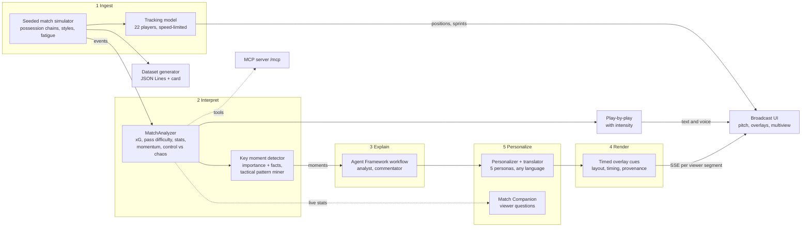
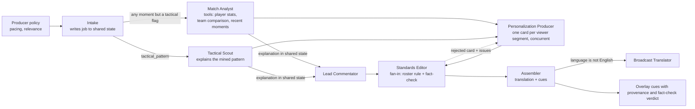
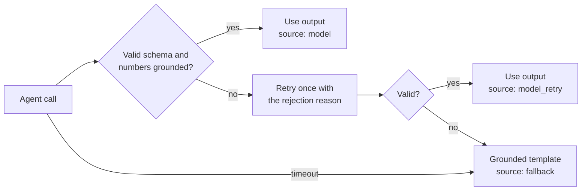
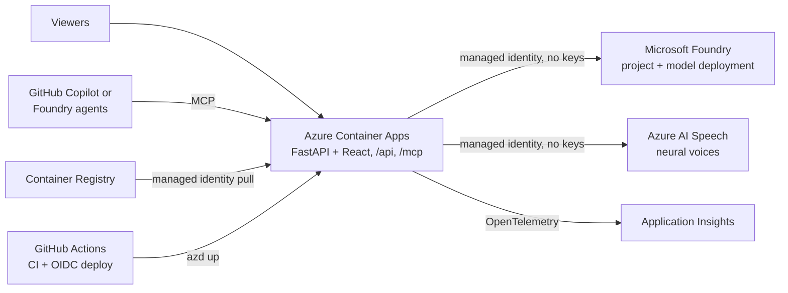

<!--
Architecture overview of Inside the Game: the five-stage pipeline, the multi-agent workflow, and the Azure deployment.
Diagrams are Mermaid so they render on GitHub and stay versioned with the code.
Each section maps a challenge requirement to the component that fulfils it.
-->

# Architecture

## Five-stage pipeline

Stages 1 and 2 are deterministic code, so the event feed keeps match pace and is fully testable. Language models
are used only where judgement and language matter (stages 3 to 5), and every model output is validated.

## Multi-agent workflow (per key moment)

| Agent | Role | Output |
|---|---|---|
| Match Analyst | Why a moment matters, with tool-based evidence | `Explanation` |
| Tactical Scout | Why a flagged tactical pattern matters (zone, defender, count, share); routed by moment kind | `Explanation` |
| Lead Commentator | One live commentary line | `Commentary` |
| Personalization Producer | Persona card in voice, vocabulary, perspective, budget | `PersonaCard` |
| Broadcast Translator | Localised card with names and numbers preserved | `TranslatedCard` |
| Match Editor | Half-time and full-time recaps | `MatchRecap` |
| Standards Editor | Fact-checks cards and commentary; sends rejected cards back for revision | `FactCheckVerdict` |
| Match Companion | Answers viewer questions, any persona and language | `CompanionAnswer` |

### Reliability: every agent call

If the workflow itself fails, a degraded template path still produces cues for every viewer. Every cue records
the source, attempts, and latency of each agent that produced it.

## Live delivery

- Interpretation runs inline at match pace; agent workflows and recaps run as background tasks.
- Viewers with identical preferences share a segment, so model cost scales with distinct preferences.
- Late joiners receive the current snapshot, recent cues, recaps, and personalized backfill of recent moments.
- Slow clients drop their oldest queued messages, never the newest.
- Moment production has backpressure: at most `PARALLEL_MOMENTS` workflows run per match, later moments queue in
  order, and non-goal moments that went stale in the queue are skipped and shown as such in the producer console.
- Each event message carries tracking for all 22 players and the fastest involved sprinter; the tracking model
  looks a few events ahead so players reach their next action on time without exceeding their top speed.
- Play-by-play lines carry an intensity (normal, raised, peak) that drives spoken delivery, through Azure AI
  Speech when configured or browser speech otherwise.
- The producer console subscribes to its own server-sent event stream, which pushes the console state only when
  it changes and ends with the match.

## Azure deployment

Provisioned by `azd up` from Bicep in `infra/`. See [DEPLOYMENT.md](DEPLOYMENT.md).
